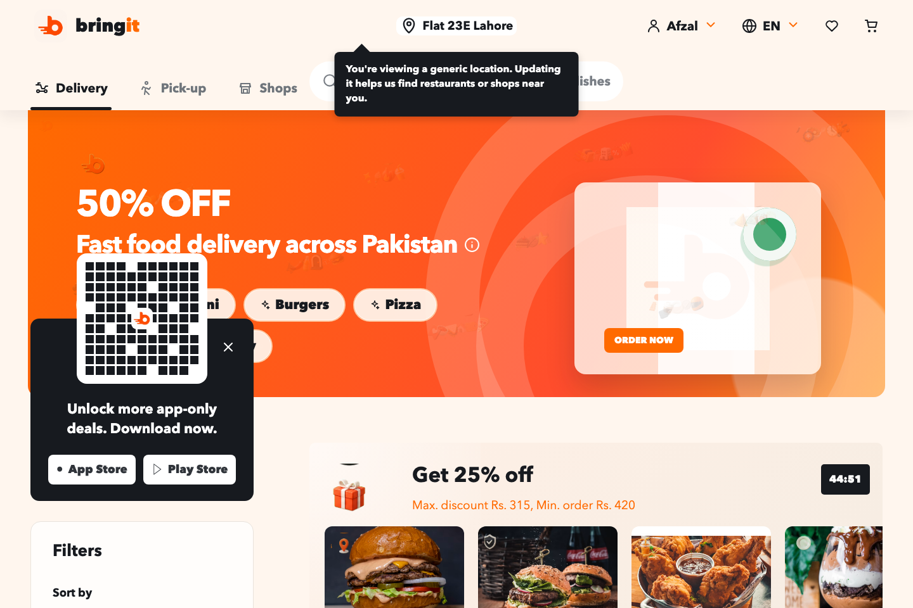
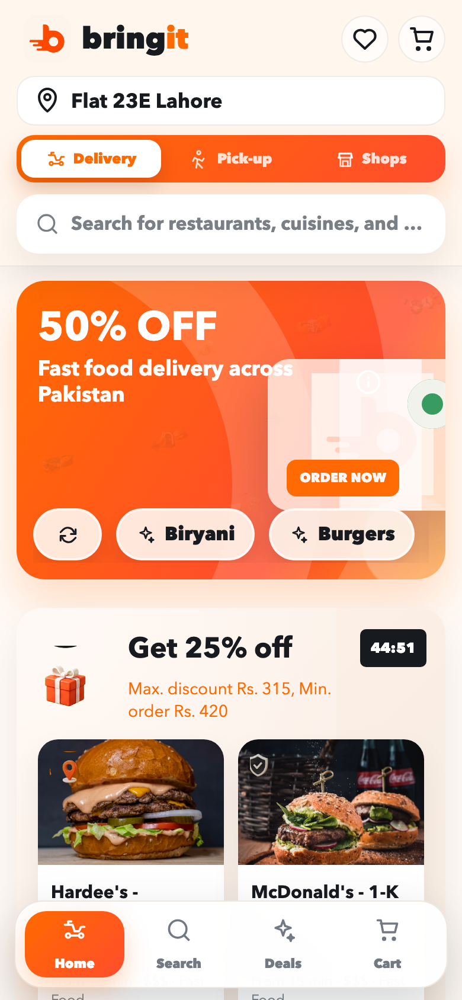
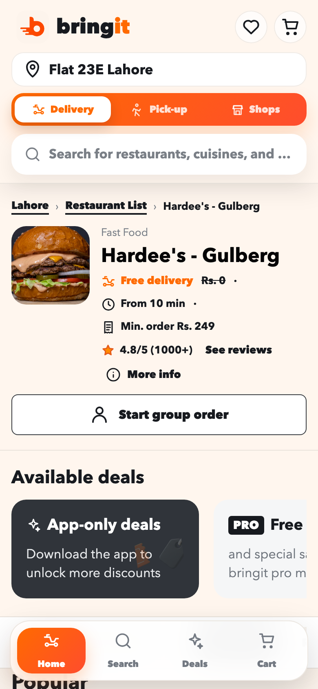
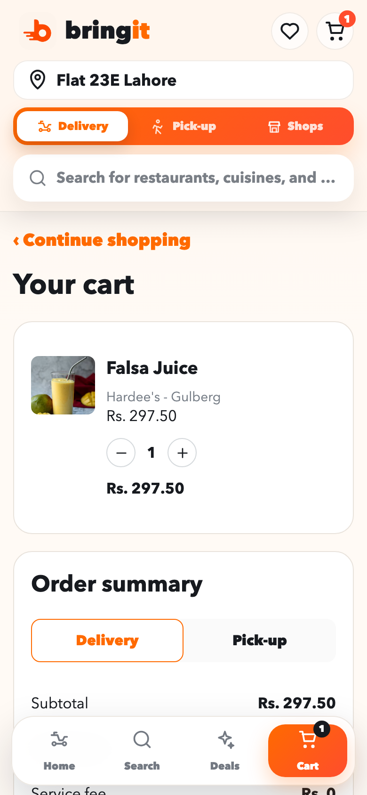
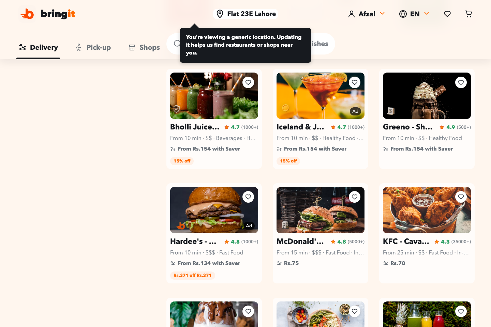

# bringit — Fast food delivery, front to back(end-optional) 🛵

**bringit** is a snappy, mobile-first food-delivery storefront for a fictional Lahore
delivery brand. Browse restaurants, dig through menus, build a cart, and glide to checkout —
all in a single-page React app that installs to your home screen like a real app. No account,
no tracking, no drama. Just a delightfully fast ordering flow you can run on your own machine
in about a minute.

> **Heads up on the brand:** *bringit* is an original demo brand and this is a hand-built
> frontend inspired by the shape of modern food-delivery apps. It ships with a self-contained
> demo seed so it runs beautifully with **zero backend**, and it can optionally talk to a real
> export API if you have one.

<p align="center">
  
</p>

---

## Why it's tasty 🍔

- **Runs with no backend.** A built-in demo seed of restaurants, menus, and deals means
  `npm run dev` gets you a fully clickable app instantly. Point it at a live export API later
  if you want real data.
- **Genuinely mobile-first.** A sticky bottom nav (Home · Search · Deals · Cart), swipeable
  rails, and touch-sized tap targets. It feels like a native app because it (almost) is one.
- **Installable PWA.** Manifest, maskable icons, and a service worker that caches the app
  shell for offline-friendly loads and an "Add to Home Screen" prompt.
- **A cart that remembers you.** Your basket is saved to `localStorage`, so a refresh (or an
  accidental swipe-away) never nukes your order. Corrupted storage is handled gracefully — a
  bad blob can never crash the cart.
- **Real routing without a router library.** Clean URLs for search, restaurants, cart, and
  checkout using the History API — plus live `<title>`, canonical, and JSON-LD SEO tags per view.
- **Full ordering flow.** Restaurant pages, item modals with variations & quantities, group
  orders, deals, an order summary with delivery/pick-up toggle, and a little confetti-worthy
  celebration on checkout. 🎉

---

## The tour 📸

| Mobile home | Restaurant page | Your cart |
| :---: | :---: | :---: |
|  |  |  |

<p align="center">
  
</p>

---

## Get it running (the one-minute version) ⏱️

You'll need **[Node.js](https://nodejs.org/) 20.19+** and npm. That's the whole shopping list.

```bash
# 1. Grab the code
git clone https://github.com/waleedsworld/p66-frontend.git
cd p66-frontend

# 2. Install the ingredients
npm install

# 3. Fire up the kitchen (dev server with hot reload)
npm run dev
```

Now open the URL Vite prints (usually **http://localhost:5173**) and start ordering. The app
falls back to its built-in demo seed automatically, so it works out of the box — no API keys,
no `.env`, no wait.

### Build for production 📦

```bash
npm run build      # bundles into dist/
npm run preview    # serve the production build locally
```

The output in `dist/` is plain static files — drop it on Vercel, Netlify, Cloudflare Pages,
GitHub Pages, or any bucket that can serve HTML. SPA fallback routing is already wired up in
`vercel.json` and `netlify.toml`, so deep links like `/restaurants/hardees-gulberg` resolve
correctly.

**Recommended host settings**

| Setting | Value |
| --- | --- |
| Build command | `npm run build` |
| Output directory | `dist` |
| Node version | `20.19` or newer |

---

## Connecting a real backend (optional) 🔌

The frontend will happily fetch live data if you have an export API. It calls:

- `GET /api/exports/<slug>/demo` — the restaurant list for the home + search views
- `GET /api/exports/<slug>/restaurants/<vendorCode>/demo` — a single restaurant's full menu

Point requests at your API by setting `VITE_API_TARGET` (the dev server proxies `/api`,
`/health`, and `/exports` to it):

```bash
VITE_API_TARGET="http://localhost:3000" npm run dev
```

If the API is missing or errors out, the app quietly uses its demo seed — so you never see a
broken screen.

---

## Under the hood 🧰

- **[React 19](https://react.dev/)** — a single, deliberately dependency-light component tree.
- **[Vite](https://vitejs.dev/)** — instant dev server and a lean production build.
- **No UI kit, no router, no state library.** Routing rides on the History API and state lives
  in React. Small footprint, easy to read, fun to hack on.
- **PWA** — `manifest.webmanifest` + a hand-rolled service worker (`public/sw.js`).

```
p66-frontend/
├── index.html                 # app shell + PWA meta
├── src/
│   ├── main.jsx               # React root + service-worker registration
│   ├── App.jsx                # the whole app: routing, data, cart, views
│   └── App.css                # the full design system
├── public/
│   ├── manifest.webmanifest   # PWA manifest
│   ├── sw.js                  # app-shell service worker
│   ├── brand/                 # bringit logo & brand assets
│   └── icons/                 # PWA icons
└── vite.config.js             # build + dev proxy config
```

---

## Live demo 🌐

Deploying soon — check back for a hosted link you can poke without cloning anything.

---

## License & notes

This is a personal demo project built to explore what a fast, honest, backend-optional
food-delivery frontend can feel like. The *bringit* name and brand assets are fictional;
restaurant and product names in the demo seed are placeholders for illustration only.

Happy ordering — may your delivery always be *From 10 min*. 🧡
