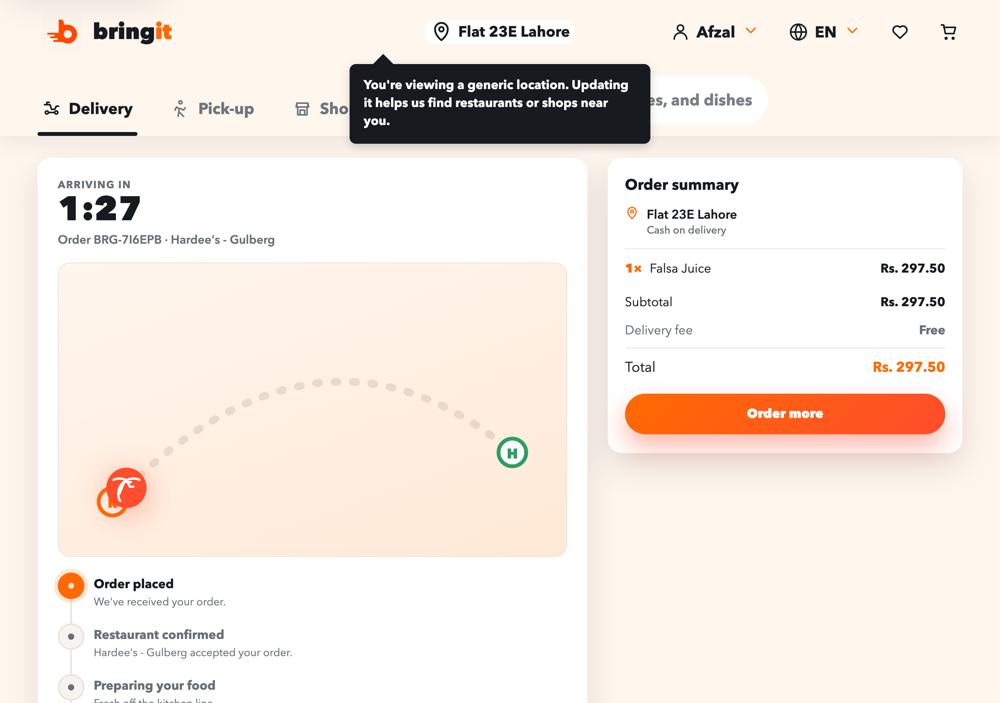
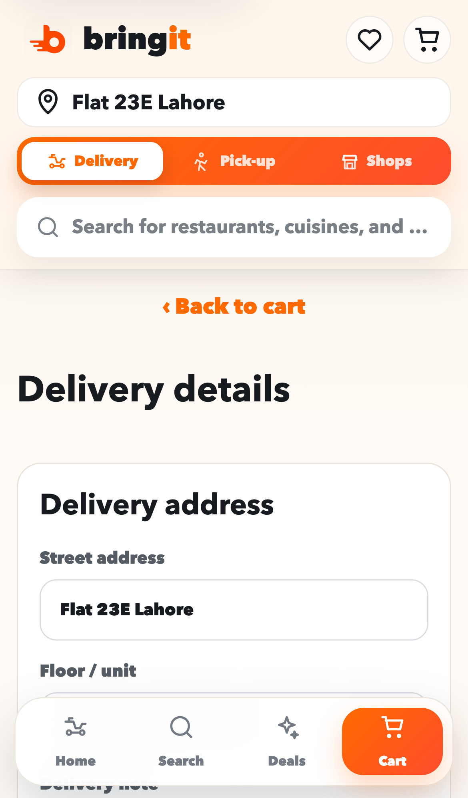

# bringit — Fast food delivery, front to back(end-optional) 🛵

<p align="center">
  
  
  
  
  = 20.19" src="https://img.shields.io/badge/node-%E2%89%A520.19-339933?logo=nodedotjs&logoColor=white" />
  
</p>

**bringit** is a snappy, mobile-first food-delivery storefront for a fictional Lahore
delivery brand. Browse restaurants, dig through menus, build a cart, glide to checkout — and
then **watch your order fly to your door on a live tracker**. It's a single-page React app that
installs to your home screen like a real app. No account, no tracking, no drama. Just a
delightfully fast ordering flow you can run on your own machine in about a minute.

> **Heads up on the brand:** *bringit* is an original demo brand and this is a hand-built
> frontend inspired by the shape of modern food-delivery apps. It ships with a self-contained
> demo seed so it runs beautifully with **zero backend**, and it can optionally talk to a real
> export API if you have one.

<p align="center">
  
</p>

<p align="center">
  <b><a href="https://bringit.techrealm.ai">🌐 Try the live demo → bringit.techrealm.ai</a></b>
</p>

---

## Why it's tasty 🍔

- **🆕 Live order tracking.** Place an order and land on a real-time tracker: a ticking
  *arriving in* countdown, an animated rider gliding along the route, a status timeline
  (placed → confirmed → cooking → on the way → delivered), and your itemised order summary.
  Orders persist to `localStorage`, so a refresh keeps you on the map.
- **Runs with no backend.** A built-in demo seed of restaurants, menus, and deals means
  `npm run dev` gets you a fully clickable app instantly. Point it at a live export API later
  if you want real data.
- **Genuinely mobile-first.** A sticky bottom nav (Home · Search · Deals · Cart), swipeable
  rails, and touch-sized tap targets — hardened for the awkward tablet band and touch devices,
  so it feels like a native app because it (almost) is one.
- **Polished to a shine.** A micro-interaction layer adds tasteful hover states, button
  press feedback, skeleton **loading states**, and friendly **empty states** — no jarring blank
  screens, ever.
- **Installable PWA.** Manifest, maskable icons, and a service worker that caches the app
  shell for offline-friendly loads and an "Add to Home Screen" prompt.
- **A cart that remembers you.** Your basket is saved to `localStorage`, so a refresh (or an
  accidental swipe-away) never nukes your order. Corrupted storage is handled gracefully — a
  bad blob can never crash the cart.
- **Accessible & fast.** A skip-to-content link, a focus-managed `#main-content` region,
  proper labels, and a code-split bundle (React vendor chunk split out) that keeps the app
  lean and keyboard-friendly.
- **Real routing without a router library.** Clean URLs for search, restaurants, cart,
  checkout, and `/order` using the History API — plus live `<title>`, canonical, and JSON-LD
  SEO tags per view.
- **A/B landing hero, no rebuild.** The home hero has two interchangeable looks selected by a
  URL flag — the default promo banner, or an editorial variant at `?variant=b` with a distinct
  headline, layout, and working CTAs. See [`docs/VARIANTS.md`](docs/VARIANTS.md).
- **Tested where it counts.** 43 unit tests (search, filters, price formatting, menu
  variations) plus Playwright e2e specs for the home and cart flows, wired to CI.

---

## The tour 📸

**The new live order tracker** — countdown, animated rider, status timeline, and order summary:

<p align="center">
  
</p>

| Mobile home | Your cart | Checkout |
| :---: | :---: | :---: |
|  |  |  |

<p align="center">
  
</p>

---

## Get it running (the one-minute version) ⏱️

You'll need **[Node.js](https://nodejs.org/) 20.19+** and npm. That's the whole shopping list.

```bash
# 1. Grab the code
git clone https://github.com/waleedsworld/p66-frontend.git
cd p66-frontend

# 2. Install the ingredients
npm install

# 3. Fire up the kitchen (dev server with hot reload)
npm run dev
```

Now open the URL Vite prints (usually **http://localhost:5173**) and start ordering. The app
falls back to its built-in demo seed automatically, so it works out of the box — no API keys,
no `.env`, no wait.

### Build for production 📦

```bash
npm run build      # bundles into dist/
npm run preview    # serve the production build locally (http://localhost:4173)
```

The output in `dist/` is plain static files — drop it on Cloudflare Pages, Vercel, Netlify,
GitHub Pages, or any bucket that can serve HTML. SPA fallback routing is already wired up in
`vercel.json` and `netlify.toml`, so deep links like `/restaurants/hardees-gulberg` and
`/order` resolve correctly.

**Recommended host settings**

| Setting | Value |
| --- | --- |
| Build command | `npm run build` |
| Output directory | `dist` |
| Node version | `20.19` or newer |

---

## Testing 🧪

```bash
npm test           # run the unit suite (Vitest) once
npm run test:watch # unit tests in watch mode
npm run test:e2e   # Playwright end-to-end specs (home + cart)
```

- **Unit** — 43 tests covering search ranking, category filters, price formatting, and menu
  variation math (`tests/unit/`).
- **E2E** — Playwright specs that click through the home and cart flows (`tests/e2e/`).
- **CI** — the suite runs on push via [`.github/workflows/ci.yml`](.github/workflows/ci.yml).

---

## Connecting a real backend (optional) 🔌

The frontend will happily fetch live data if you have an export API. It calls:

- `GET /api/exports/<slug>/demo` — the restaurant list for the home + search views
- `GET /api/exports/<slug>/restaurants/<vendorCode>/demo` — a single restaurant's full menu

Point requests at your API by setting `VITE_API_TARGET` (the dev server proxies `/api`,
`/health`, and `/exports` to it):

```bash
VITE_API_TARGET="http://localhost:3000" npm run dev
```

If the API is missing or errors out, the app quietly uses its demo seed — so you never see a
broken screen.

---

## Under the hood 🧰

- **[React 19](https://react.dev/)** — a single, deliberately dependency-light component tree.
- **[Vite](https://vitejs.dev/)** — instant dev server and a lean, code-split production build.
- **No UI kit, no router, no state library.** Routing rides on the History API and state lives
  in React. Small footprint, easy to read, fun to hack on.
- **PWA** — `manifest.webmanifest` + a hand-rolled service worker (`public/sw.js`).
- **Tests** — Vitest for units, Playwright for e2e.

```
p66-frontend/
├── index.html                 # app shell + PWA + SEO meta
├── src/
│   ├── main.jsx               # React root + service-worker registration
│   ├── App.jsx                # the whole app: routing, data, cart, views
│   ├── App.css                # the full design system
│   ├── OrderTracking.jsx/.css # 🆕 live order tracker page + logic
│   ├── HeroVariants.jsx/.css  # A/B editorial hero (?variant=b)
│   ├── enhance.css            # micro-interaction & loading/empty-state polish
│   └── robustness.css         # responsive hardening for tablet/touch
├── tests/                     # Vitest unit + Playwright e2e
├── public/                    # manifest, sw, brand, icons, favicons, OG card
└── vite.config.js             # build + dev proxy config
```

---

## Found by search & social 🔎

bringit is built to be *discoverable*, not just deployable:

- **SEO meta** — a live `<title>`, `description`, and `canonical` that update per view
  (home, search, restaurant, cart, order) through the History-API router.
- **Structured data** — static `Organization` + `WebSite` (with a `SearchAction`) JSON-LD in
  `index.html`, plus per-view `Restaurant`/`WebSite` JSON-LD emitted at runtime.
- **Rich social cards** — Open Graph + Twitter/X `summary_large_image` tags backed by a
  ready-made 1200×630 card at [`public/og-image.png`](public/og-image.png).
- **Crawler basics** — [`public/robots.txt`](public/robots.txt) and
  [`public/sitemap.xml`](public/sitemap.xml) covering home, sample searches, and restaurant pages.
- **A full favicon set** — `favicon.svg` (scalable), `favicon.ico`, 16/32 px PNGs, Apple
  touch icon, and maskable PWA icons.

---

## Scripts 📜

| Command | What it does |
| --- | --- |
| `npm run dev` | Dev server with hot reload (http://localhost:5173) |
| `npm run build` | Production bundle into `dist/` |
| `npm run preview` | Serve the production build locally (http://localhost:4173) |
| `npm start` | Serve the build on `0.0.0.0` (handy for containers) |
| `npm test` | Run the Vitest unit suite |
| `npm run test:watch` | Unit tests in watch mode |
| `npm run test:e2e` | Playwright end-to-end specs |

---

## Live demo 🌐

**[bringit.techrealm.ai](https://bringit.techrealm.ai)** — poke the whole ordering flow (browse →
cart → checkout → live tracking) without cloning a thing. Deployed on Cloudflare Pages straight
from `main`.

---

## License & notes

Released under the [MIT License](LICENSE) — free to use, fork, and learn from.

This is a personal demo project built to explore what a fast, honest, backend-optional
food-delivery frontend can feel like. The *bringit* name and brand assets are fictional;
restaurant and product names in the demo seed are placeholders for illustration only.

Happy ordering — may your delivery always be *From 10 min*. 🧡
